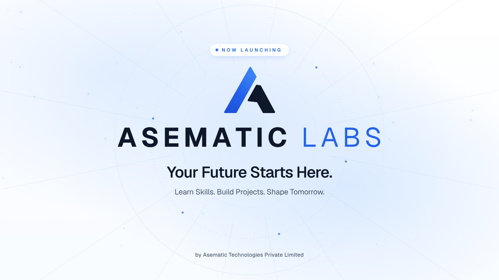

# Asematic Labs — 15-second launch film (Remotion)

A 1920 × 1080, 30 fps, exactly 450-frame (15.000 s) brand launch film for **Asematic Labs**,
by Asematic Technologies Private Limited. Built entirely in code with Remotion, React and TypeScript:
vector graphics, UI mockups, synthesized score and sound design, and a locally generated voice-over.

**Final render:** [`asematic-labs-launch.mp4`](asematic-labs-launch.mp4): H.264 High, yuv420p BT.709,
AAC 320 kbps stereo, −16.3 LUFS integrated, −2.7 dBTP true peak.



## Storyboard

| Time | Frames | Scene | File |
| --- | --- | --- | --- |
| 0.00–2.50 s | 0–74 | **Brand genesis.** The camera tracks a luminous comet line in close-up, flies forward through a 3D node network, then the `ASEMATIC LABS` wordmark rises out of a mask with a spring settle. Tagline *Learn. Build. Innovate.* A blue light sweep carries into scene 2. | `src/scenes/Scene01BrandGenesis.tsx` |
| 2.50–5.25 s | 75–157 | **Learning experience.** A perspective cluster of a learning-path browser, a code editor that types a React component, a terminal running tests, and status chips. Camera pushes in, travels laterally, then eases back. Zoom-through transition into a pale-blue surface. | `src/scenes/Scene02Learning.tsx` |
| 5.25–8.00 s | 158–239 | **Real projects.** The camera passes through a geometric frame. An Express API editor, a project dashboard, a mobile portfolio preview and a data-viz card assemble in depth with staggered springs, then align into a grid of card shells. | `src/scenes/Scene03Projects.tsx` |
| 8.00–11.50 s | 240–344 | **Skills and opportunities.** The grid becomes four learning-track cards with custom vector illustrations (Full Stack, Data Science, AI & ML, Internship & Project-Based Learning). The camera travels across them, zooms out, then the cards converge into a single blue point. | `src/scenes/Scene04Opportunities.tsx` |
| 11.50–15.00 s | 345–449 | **Hero reveal.** The point blooms into rings and rays. The mark draws on and fills, letters arrive one by one, then the headline, supporting line, *NOW LAUNCHING* and the parent-company credit. Everything is in place by 13.6 s, followed by a stable hold. | `src/scenes/Scene05FinalReveal.tsx` |

Scenes overlap by 12-frame transitions whose midpoints sit exactly on the brief's boundaries
(`src/utils/timing.ts` throws if the arithmetic stops adding up to 450).

## Vertical announcement reel (Hinglish)

**Render:** [`asematic-labs-reel.mp4`](asematic-labs-reel.mp4) — composition `AsematicLabsReel`,
1080 × 1920 (9:16), 30 fps, 1000 frames (33.3 s), −16.5 LUFS. Post caption: `docs/reel-caption.txt`.

| Time | Scene (`src/reel/scenes/`) | Voice-over |
| --- | --- | --- |
| 0–3.5 s | `ReelHook`: megaphone, "New announcement", words pop as spoken | "Students ke liye ek exciting announcement hai!" |
| 3.5–10.5 s | `ReelIntro`: logo draws, **Introducing ASEMATIC LABS**; "Concepts" is struck out and "Real-world projects" lights up | "Introducing Asematic Labs — ek aisi learning initiative jahan aap sirf concepts nahi," |
| 10.5–14.5 s | `ReelProjects`: dashboard, code and phone assemble; skill chips pop | "real-world projects ke through skills build kar sakte ho." |
| 14.5–19.2 s | `ReelTracks`: three track cards as each is named; **Web Development · Data Science · AI/ML** | "Explore karo Web Development, Data Science aur AI/ML." |
| 19.2–25.1 s | `ReelIdeas`: Learn ✓ Build ✓, idea bulb, wireframe becomes a real app, "Start building" tapped | "Learn karo, build karo, aur apne ideas ko reality mein convert karna start karo." |
| 25.1–33.3 s | `ReelEnd`: logo, **Learn. Build. Launch.**, **Follow @asematic.tech** card tapped to "Following" | "Asematic Labs — Learn. Build. Launch. Follow us for learning resources, projects aur upcoming programs!" |

- **Length:** the brief planned 25 s, but the script is about 30 s of speech at a clear, natural
  pace. Reading it faster made English words blur (for example "Data Science" was heard as
  "theatre science"), so the reel is 33.3 s, keeping the brief's hook → voice-over → ending order.
- **Voice:** a professional male narrator: Kokoro `hm_omega` (Indian accent) blended 30% with
  `am_michael` (deep, polished narrator tone), pitched 0.5 semitone lower. Listen alone:
  `docs/reel-voice-only.m4a`. Hinglish is generated from segments:
  Hindi words in Devanagari and phonemised as Hindi, English words phonemised as English
  (`scripts/make_reel_narration.py`). Whisper and a strict CTC recogniser both hear every English
  word, and Whisper translates the Hindi parts correctly.
- **Music:** original 33 s score, `scripts/make_reel_audio.py` (sonic-logo peak on the tagline).
  Effects are shared with the launch film.

```bash
npm run render:reel                              # → asematic-labs-reel.mp4
KOKORO_DIR=. npm run reel:narration              # regenerate the Hinglish voice-over
npm run reel:audio                               # regenerate the reel music
```

## Project structure

```
asematic-labs-launch/
├── asematic-labs-launch.mp4        final render
├── remotion.config.ts              codec / quality / colour settings
├── scripts/
│   ├── make_narration.py           voice-over (Kokoro-82M TTS, local)
│   └── make_audio.py               score + sound effects (numpy/scipy synthesis)
├── src/
│   ├── Root.tsx                    composition `AsematicLabsLaunch` + per-scene compositions
│   ├── AsematicLabsLaunch.tsx      timeline, transitions, overlays and the audio mix
│   ├── scenes/                     Scene01…Scene05
│   ├── components/                 Background, ParticleField, LightSweep, ZoomTransition,
│   │   │                           LogoMark, Wordmark, FloatingInterface, LearningCards
│   │   └── interfaces/             CodePanel, LessonBrowser, Terminal, Dashboard, PhonePreview, ChartCard
│   ├── styles/brand.ts             colours, shadows, type styles, font loading
│   ├── utils/                      animations.ts (easing, springs), timing.ts, cardLayout.ts
│   └── generated/narration.json    measured narration line lengths (written by make_narration.py)
└── public/
    ├── audio/                      music.wav, narration/*.wav, sfx/*.wav
    ├── fonts/                      Geist + Geist Mono variable (SIL OFL, licence included)
    └── logo/                       asematic-labs-mark-temporary.svg
```

## Setup and rendering

Requires Node.js 18+ (tested on Node 22.22, npm 10.9).

```bash
npm install
npm run dev          # Remotion Studio: preview and edit (each scene is also its own composition)
npm run render       # → asematic-labs-launch.mp4 (full quality, ~1.5 min on 4 cores)
npm run render:audio # → out/audio-preview.m4a (soundtrack only, to check the voice first)
npm run render:preview   # → out/preview.mp4 at half resolution
npm run lint         # eslint + tsc
```

Remotion downloads its own headless Chrome on first render. If that download is blocked (as it was
in the sandbox this was built in), point it to an installed Chrome or headless shell:

```bash
REMOTION_BROWSER_EXECUTABLE=/path/to/chrome-headless-shell npm run render
```

Rendering is fully offline: fonts, audio and graphics are all local and nothing is fetched at render time.

### Regenerating audio (optional; the generated files are committed)

```bash
pip install numpy scipy soundfile pyloudnorm sherpa-onnx
npm run audio                                   # music + effects
# narration: download the Kokoro model files once (≈350 MB, not committed)
pip install kokoro-onnx
curl -LO https://github.com/thewh1teagle/kokoro-onnx/releases/download/model-files-v1.0/kokoro-v1.0.onnx
curl -LO https://github.com/thewh1teagle/kokoro-onnx/releases/download/model-files-v1.0/voices-v1.0.bin
KOKORO_DIR=. npm run narration
```

If narration lengths change, `src/generated/narration.json` updates automatically and the music ducking
follows. Check that the start frames in `src/utils/timing.ts` still leave natural gaps.

## Dependencies

| Package | Why |
| --- | --- |
| `remotion`, `@remotion/cli` 4.0.535 | Composition, frame-based animation, rendering (latest stable at build time) |
| `@remotion/transitions` | `TransitionSeries`, plus a custom zoom-through presentation (`ZoomTransition.tsx`) |
| `@remotion/media` | `<Audio>` for music, narration and effects with per-frame volume |
| `@remotion/fonts` | Loads the bundled Geist fonts |
| `lucide-react` | A handful of UI icons inside the mockups and cards |
| `react`, `react-dom`, `typescript`, `eslint`, `prettier` | From the Remotion blank template |

Intentionally **not** used: `@remotion/three` (layered SVG plus CSS perspective gave cleaner, faster
depth), `gsap` and `react-spring` (Remotion's own `spring`/`interpolate` keep every frame deterministic),
`@remotion/motion-blur` (a velocity-based blur inside the zoom transitions does the job at a fraction
of the render cost), and Google-hosted fonts (bundled instead, so renders never touch the network).

Python tooling (only for regenerating audio): numpy, scipy, soundfile, pyloudnorm, kokoro-onnx.

## Audio

- **Voice-over** (final): Kokoro-82M (Apache-2.0) voice **`af_heart`**, a clear international English
  female voice, generated locally (no API key or paid service). This is the voice from the first
  version of the film, which was approved, with its pronunciation fixed:
  - "Asematic" is now **"a-SEM-uh-tik"** (`ɐsˈɛmətɪk`), with the stress on SEM so the "se" is clearly
    heard. The first version stressed "MAT" ("ass-eh-MAT-ik"); a strict recogniser heard that as
    "asatic", and it sounded like "AsemAtic".
  - Read 5% slower, with a voice EQ, light compression and upbeat punctuation.
  - Checked with Whisper and a strict NeMo CTC recogniser: every English word of the script is
    transcribed correctly, and the brand is heard with a clear middle "se" in both lines.
  - Listening files: `docs/voice-final/voice-only-af_heart.m4a` and `soundtrack-af_heart.m4a`.
  - Alternatives kept for reference:
    - The Indian English VCTK voice (`NARRATION_ENGINE=vctk`, `docs/voice-final/*vctk-p248*`).
    - The earlier Kokoro demos (`docs/voice-demos/`).

  | Line | Starts |
  | --- | --- |
  | "Welcome to Asematic Labs." | 0.33 s |
  | "Learn industry-ready skills," | 2.80 s |
  | "build real-world projects," | 5.33 s |
  | "and turn your potential into opportunity!" | 7.53 s |
  | "Your future starts here!" | 10.60 s |
  | "Asematic Labs, now launching." | 12.40 s |

- **Score**: original, synthesized in `scripts/make_audio.py`. D major at 120 BPM: a pad swell, a pluck
  arpeggio and a soft pulse from 2.5 s, a build with riser, a peak on Dmaj9 at 11.5 s with a four-note
  bell motif as the sonic logo, then a natural decay to silence by 15 s.
- **Sound effects**: also synthesized: rise, particle shimmer, logo hit, light sweep, whooshes, UI
  clicks, keyboard, confirmation tone, card placements, short riser, digital ambience.
- **Mix** (`src/AsematicLabsLaunch.tsx`): music ducks ~14 dB under every spoken line with 6-frame ramps;
  final master measures −16.3 LUFS, −2.7 dBTP. An offline Whisper (small.en) transcription of the
  final mix returns the full script word for word. The final MP4 uses demo 1, and its soundtrack is
  identical to `docs/voice-demos/demo-1-energetic-indian.m4a`.

## Replacing the temporary logo

No official Asematic Labs logo exists in this repository. The mark used here is a **vector re-drawing
of the parent Asematic Technologies "A" mark** (traced from `launch-video/assets/lockup-original.png`),
paired with a typographic `ASEMATIC LABS` lockup. Treat it as a placeholder, not an official asset.

To swap in the official logo:

1. Put the file in `public/logo/` (SVG preferred, e.g. `public/logo/asematic-labs-logo.svg`).
2. In `src/components/LogoMark.tsx`, replace the two `<path>` groups with an
   `` (from `remotion`),
   using the existing `fill` prop as its opacity so the reveal timing still works. If the logo is an SVG
   with simple paths, you can instead paste its paths into `MARK_BLUE` / `MARK_DARK` and keep the
   draw-on animation.
3. If the official logo includes its own wordmark, remove `<Wordmark … />` from
   `src/scenes/Scene05FinalReveal.tsx` (and optionally Scene 1), or keep it if the logo is a mark only.
4. `npm run render`.

## Notes

- All text is editable through composition props in Studio (`src/Root.tsx`, and the scene props in
  `src/AsematicLabsLaunch.tsx`).
- Copy stays inside the 5% title-safe area. During camera moves, some UI panels and cards
  intentionally pass beyond the frame edge.
- UI content in the mockups (module names, code, test output, dashboard figures) is illustrative.
  It is not real student data or a claim about the programme.
